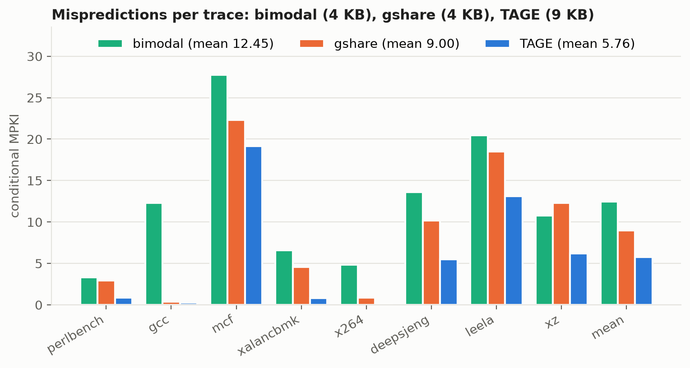
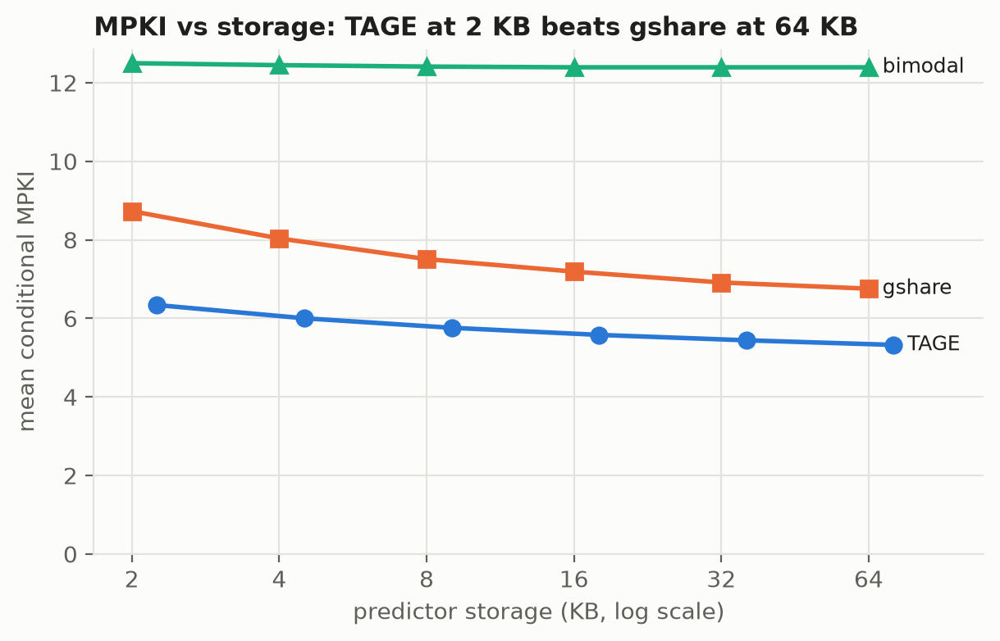
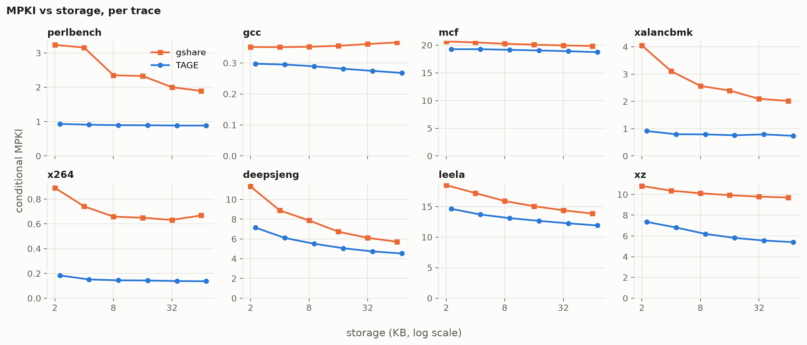
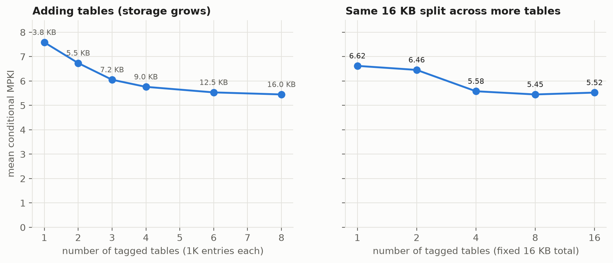
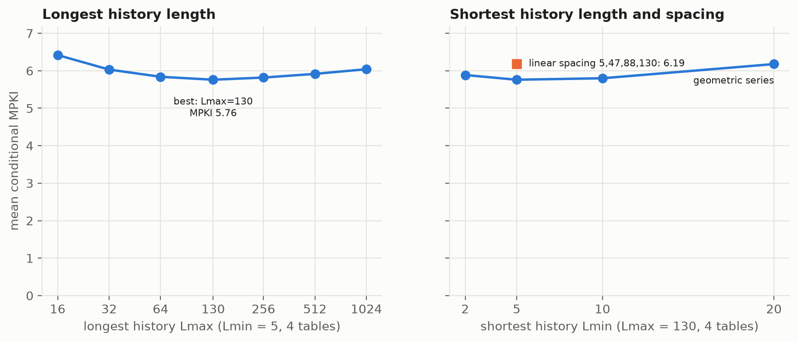
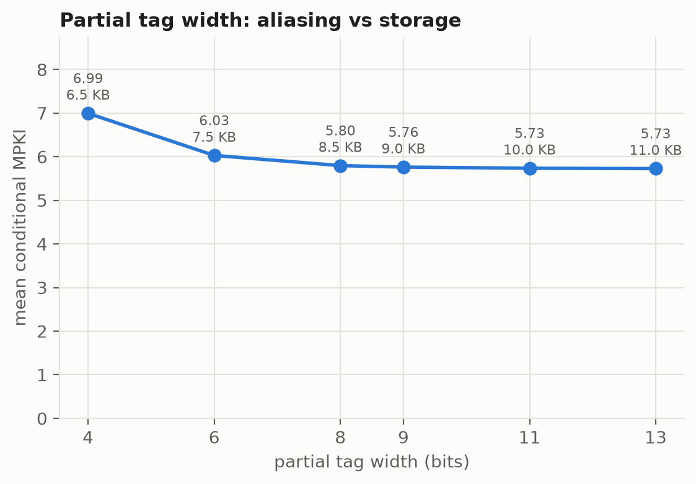

# Implementing and Evaluating the TAGE Branch Predictor

**Course project P14, Advanced Computer Architecture**
Arya Mirani

## 1. Goal

Implement a simplified TAGE predictor (a base predictor plus 4 partially tagged tables) in ChampSim's branch-predictor interface. Compare it against bimodal and gshare, and measure how the number of tables, the history lengths, the storage budget and the tag width affect misprediction rate (MPKI) and IPC.

Primary reference: A. Seznec and P. Michaud, *A Case for (Partially) TAgged GEometric History Length Branch Prediction*, JILP 8, 2006. Supplementary: A. Seznec, *A New Case for the TAGE Branch Predictor*, MICRO 2011.

## 2. Background: why TAGE works

A global-history predictor such as gshare has to pick **one** history length. If the history is short, branches that correlate with distant outcomes cannot be learned. If it is long, every branch spreads across many table entries, so the predictor learns slowly and suffers more aliasing. TAGE removes that trade-off with three ideas.

**Geometric history lengths.** Tagged table *Ti* is indexed with a hash of the PC and the most recent *L(i)* global-history bits, where

  L(i) = Lmin · (Lmax / Lmin)^((i−1)/(N−1))

With Lmin = 5, Lmax = 130 and N = 4 this gives 5, 15, 44, 130. A geometric series spends most tables on short and medium histories, which most branches need, while one table still reaches very long correlations. A few tables therefore cover a range that would need dozens of linearly spaced tables.

**Partial tagging.** Each tagged entry stores a short tag (9 bits by default) computed from the PC and the history. A table only provides a prediction when the tag matches. Tags make the long-history tables usable: without them, every branch would read *some* entry of every table and the longest table would mostly return noise from aliased branches. The tags do not need to be full width, because a false match only has to be rare, not impossible.

**Provider and alternate prediction.** On a lookup, the hitting table with the longest history is the *provider*. The next-longest hit, or the bimodal base table if there is none, is the *alternate prediction* (altpred). The provider's 3-bit signed counter normally gives the prediction.

**Allocation and update policy** (the parts that make TAGE learn well):
- **Allocate on a misprediction.** If the final prediction was wrong and the provider was not the longest table, a new entry is allocated in a *longer* table whose useful counter `u` is 0. If several are free, the shortest one is chosen with probability 2/3. If none is free, the `u` counters of the candidates are decremented, so a slot frees up later. The new entry starts weak (counter 0 or −1) in the direction of the outcome.
- **Useful counter.** `u` (2 bits) is incremented when the provider was right *and* altpred was wrong, and decremented in the opposite case. It marks entries that carry information the shorter histories do not, which protects them from replacement.
- **Graceful reset.** Every 256K conditional branches the MSB, then on the next period the LSB, of all `u` counters is cleared. This lets stale entries become replaceable again.
- **Use alternate on newly allocated.** A freshly allocated entry has seen only one outcome. When the provider's counter is weak and `u = 0`, a 4-bit global counter `USE_ALT_ON_NA` learns whether altpred is the better bet in that situation, and the predictor follows it.

## 3. Implementation

All code is in `predictors/tage/` (`tage.h`, `tage.cc`, about 300 lines). `setup.sh` links it into ChampSim as the `tage` branch module.

| Component | Default configuration |
|---|---|
| Base predictor T0 | 8K × 2-bit bimodal counters, PC-indexed (2 KB) |
| Tagged tables T1–T4 | 1K entries each; entry = 3-bit counter + 9-bit tag + 2-bit `u` = 14 bits |
| History lengths | geometric, Lmin = 5, Lmax = 130 → 5, 15, 44, 130 |
| Global history | 4096-bit circular buffer plus a 16-bit path history |
| Index / tag hashing | PC ⊕ folded history ⊕ path bits; tag = PC ⊕ fold(L, tag) ⊕ fold(L, tag−1) ≪ 1 |
| Total storage | 9.0 KB |

**Folded history.** Hashing hundreds of history bits on every branch would be slow, and in hardware it would need a very wide XOR tree. As in Seznec's implementation, each table keeps its history *folded* into an index-width (and tag-width) register using a circular shift register. Each update shifts in the newest outcome, XORs out the bit that has just left the L-bit window, and folds the overflow bit back in. This costs O(1) per branch regardless of L.

**ChampSim integration.** ChampSim calls `predict_branch()` and then immediately `last_branch_result()` for each branch, in program order (`O3_CPU::do_predict_branch`). The prediction and the update therefore see the same history, so no speculative-history repair is needed. All branch types update the global history; only conditional branches look up and train the tables. Unconditional branches return "taken", and their targets come from ChampSim's BTB, return-address stack and indirect predictor.

**Run-time parameters.** The geometry is read from environment variables when the predictor initialises (`TAGE_NUM_TABLES`, `TAGE_MIN_HIST`, `TAGE_MAX_HIST`, `TAGE_HIST_LIST`, `TAGE_LOG_BASE`, `TAGE_LOG_TAGGED`, `TAGE_TAG_BITS`), so one binary covers every sweep. The predictor prints its exact configuration and storage at start-up. For storage-matched comparisons I added `gshare_param` and `bimodal_param`, which have run-time table sizes. The stock ChampSim `bimodal` and `gshare` (16K counters, 4 KB each) are the baselines.

## 4. Methodology

**Traces.** Eight SPEC CPU2017 traces from the DPC-3 set, chosen for diverse branch behaviour: perlbench, gcc, mcf, xalancbmk, x264, deepsjeng, leela and xz. Only the first 120M instructions of each trace are used.

**MPKI.** I use *conditional-branch MPKI*: direction mispredictions of conditional branches per 1000 instructions. This isolates the direction predictor from BTB effects. It is measured with `tools/bp_driver`, a trace replayer that compiles the **same predictor source files** ChampSim uses and calls them in the same order ChampSim does. It has no pipeline model, so a 120M-instruction run takes about a second instead of tens of minutes, which makes long windows practical: **20M warmup + 100M measured instructions**. It was validated against full ChampSim runs on the same windows (Section 5.7).

**IPC.** IPC comes from full ChampSim out-of-order timing simulation with the default ChampSim core configuration (352-entry ROB, 6-wide fetch). Each run uses 10M warmup + 10M simulated instructions. The runs used IIIT's Ada cluster through SLURM.

Means: MPKI is averaged arithmetically across traces and IPC geometrically.

## 5. Results

### 5.1 TAGE vs bimodal vs gshare



| trace | bimodal (4 KB) | gshare (4 KB) | TAGE (9 KB) | TAGE vs gshare |
|---|---|---|---|---|
| perlbench | 3.31 | 2.92 | 0.90 | −69% |
| gcc | 12.28 | 0.37 | 0.29 | −21% |
| mcf | 27.76 | 22.34 | 19.14 | −14% |
| xalancbmk | 6.59 | 4.57 | 0.79 | −83% |
| x264 | 4.83 | 0.85 | 0.14 | −83% |
| deepsjeng | 13.59 | 10.18 | 5.51 | −46% |
| leela | 20.48 | 18.52 | 13.11 | −29% |
| xz | 10.78 | 12.31 | 6.19 | −50% |
| **mean** | **12.45** | **9.00** | **5.76** | **−36%** |

TAGE has the lowest MPKI on every trace. Its largest gains are on xalancbmk, x264 and perlbench, whose branches correlate with history beyond gshare's 14 bits; TAGE's 44- and 130-bit tables capture those correlations. Two other traces stand out:
- On **xz**, gshare is *worse* than bimodal (12.31 vs 10.78). Its 14-bit history spreads each branch over many counters and causes destructive aliasing. TAGE avoids this because it falls back to the base table, or to a short-history table, whenever the longer tables have nothing useful.
- **mcf** and **leela** remain hard for every predictor. Their branches depend on data (pointer-chasing comparisons in mcf, game-tree search in leela) rather than on branch history, so no history length helps much.

Part of the comparison above is TAGE's larger storage (9 KB vs 4 KB). Section 5.2 removes that factor.

### 5.2 Storage budget



| storage | bimodal | gshare | TAGE |
|---|---|---|---|
| ~2 KB | 12.50 | 8.73 | 6.34 (2.25 KB) |
| ~4 KB | 12.45 | 8.04 | 6.00 (4.5 KB) |
| ~8 KB | 12.41 | 7.51 | 5.76 (9 KB) |
| ~16 KB | 12.39 | 7.19 | 5.58 (18 KB) |
| ~32 KB | 12.39 | 6.91 | 5.44 (36 KB) |
| ~64 KB | 12.39 | 6.76 | 5.33 (72 KB) |

- **TAGE at 2.25 KB (6.34 MPKI) beats gshare at 64 KB (6.76).** That is better accuracy with about 28× less storage. At matched budgets TAGE is 21–27% better than gshare.
- **Bimodal stops improving at about 4 KB.** It has no history, so once every static branch has its own counter, more entries are wasted.
- **Both history-based predictors show diminishing returns.** Each doubling of storage gains less, and for TAGE 0.1–0.3 MPKI per doubling. The remaining mispredictions are dominated by mcf and leela, which more capacity does not fix (see the per-trace figure below).



### 5.3 Number of tagged tables



| tables | 1K entries each: storage → MPKI | fixed 16 KB budget: MPKI |
|---|---|---|
| 1 | 3.75 KB → 7.59 | 6.62 |
| 2 | 5.5 KB → 6.74 | 6.46 |
| 3 | 7.25 KB → 6.05 | – |
| 4 | 9.0 KB → 5.76 | 5.58 |
| 6 | 12.5 KB → 5.53 | – |
| 8 | 16.0 KB → 5.45 | 5.45 |
| 16 | – | 5.52 |

- **Adding tables helps, with diminishing returns.** Going from 1 to 4 tables cuts MPKI by 24%; going from 4 to 8 cuts only another 5%.
- **The number of different history lengths matters more than raw capacity.** At a fixed 16 KB, a single 8K-entry tagged table (6.62) is clearly worse than four 1K-entry tables using only 9 KB (5.76).
- **Under a fixed budget, about 8 tables is the sweet spot.** At 16 tables each table has only 512 entries. Capacity per history length starts to hurt, and the tables lie so close in history length that they duplicate each other.

### 5.4 History lengths



| Lmax (Lmin = 5) | 16 | 32 | 64 | **130** | 256 | 512 | 1024 |
|---|---|---|---|---|---|---|---|
| mean MPKI | 6.42 | 6.03 | 5.84 | **5.76** | 5.82 | 5.92 | 6.04 |

| Lmin (Lmax = 130) | 2 | **5** | 10 | 20 | linear 5,47,88,130 |
|---|---|---|---|---|---|
| mean MPKI | 5.89 | **5.76** | 5.80 | 6.18 | 6.19 |

- **Lmax has a clear optimum near 130.** If Lmax is too short, long correlations are lost. If it is too long, the geometric series becomes too coarse with only 4 tables (for example 5, 29, 174, 1024): the middle lengths that most branches need are skipped, and the 1024-bit table takes long to train.
- **Lmin of about 5 is best.** Raising it to 20 removes the short-history table, which many simple branches rely on (6.18).
- **Geometric spacing beats linear spacing over the same range by 7%** (5.76 vs 6.19). Linear spacing wastes tables on similar long histories and leaves too little resolution at short lengths. This is the central argument of the TAGE paper.

### 5.5 Partial tag width



| tag bits | 4 | 6 | 8 | **9** | 11 | 13 |
|---|---|---|---|---|---|---|
| storage | 6.5 KB | 7.5 KB | 8.5 KB | 9.0 KB | 10.0 KB | 11.0 KB |
| mean MPKI | 6.99 | 6.03 | 5.80 | **5.76** | 5.73 | 5.73 |

- **Short tags cause false hits.** With 4-bit tags, about 1 in 16 lookups of an unrelated branch matches, and the predictor trusts a wrong entry: MPKI rises by 21%.
- **Beyond about 8–9 bits there is no further gain** (5.73 at 11 and 13 bits) because false hits are already rare. Extra tag bits only cost storage.

This is why TAGE can use *partial* tags: a short tag removes almost all of the harmful aliasing at a fraction of the cost of full tags.

### 5.6 IPC

*(IPC results from the ChampSim timing runs on Ada will be added here: per-trace IPC for the baselines, IPC vs storage, and IPC vs MPKI across all configurations.)*

### 5.7 Validation of the MPKI methodology

To check that the trace-driven driver measures the same thing as ChampSim, both were run on identical windows (10M warmup + 10M measured). The table shows ChampSim's `BRANCH_CONDITIONAL` MPKI minus the driver's MPKI:

| trace | bimodal | gshare | TAGE |
|---|---|---|---|
| perlbench | 0.064 | 0.072 | 0.073 |
| gcc | 0.026 | 0.033 | 0.036 |
| mcf | 5.488 | 5.489 | 5.496 |
| xalancbmk | 0.547 | 0.543 | 0.548 |
| x264 | −0.001 | 0.000 | 0.000 |
| deepsjeng | 0.875 | 1.185 | 1.223 |
| leela | 0.783 | 0.739 | 0.782 |
| xz | 0.124 | 0.126 | 0.125 |

For each trace the gap is **nearly the same for all three predictors**, so it does not come from the direction predictor. It comes from the BTB. ChampSim also counts a conditional branch as mispredicted when it is correctly predicted taken but the BTB has no target for it. That depends only on the trace and the BTB, not on the direction predictor. mcf has by far the largest such offset (5.5 MPKI with every predictor), so its ChampSim MPKI overstates the direction predictor's errors. The small predictor-to-predictor variation, as on deepsjeng, arises because a more accurate predictor predicts more taken branches correctly and therefore exposes more of them to BTB misses.

Both methods **rank the three predictors identically on all 8 traces**. The driver's direction MPKI is therefore the right metric for comparing direction predictors, and it can use 10× longer windows. As a further check, the full 360-run MPKI sweep was run on both macOS/ARM (Apple clang) and Linux/x86 (Ada, GCC 11), and all 360 misprediction counts match exactly.

## 6. Conclusions

1. A simplified 4-table TAGE cuts conditional MPKI by 36% compared with ChampSim's gshare and by 54% compared with bimodal, across 8 SPEC2017 traces.
2. Its advantage does not come from extra storage: TAGE at 2.25 KB beats gshare at 64 KB.
3. Using several history lengths matters more than total capacity. Geometric spacing is clearly better than linear spacing, with an optimum near Lmax ≈ 130 and Lmin ≈ 5 for 4 tables.
4. Partial tags of about 8–9 bits are enough. Shorter tags cause false hits; longer tags only add storage.
5. Data-dependent branches (mcf, leela) dominate the remaining mispredictions. History-based prediction cannot remove them, whatever its size.

## 7. Reproducing

```
./setup.sh                      # clone ChampSim at the pinned commit, link predictors/
scripts/get_traces.sh           # first 80 MB of each DPC-3 trace
cd ChampSim && vcpkg/bootstrap-vcpkg.sh && vcpkg/vcpkg install
./config.sh ../configs/all.json && make -j && cd ..
tools/build_driver.sh
# MPKI sweep (trace-driven, minutes)
mkdir -p traces/branches
for t in traces/*.xz; do
  b=$(basename $t .champsimtrace.xz)
  tools/bp_driver extract $t traces/branches/$b.br 120000000
done
python3 scripts/run_mpki.py
# IPC sweep (ChampSim timing, hours; on Ada: sbatch ada/ipc.sbatch)
python3 scripts/run_sweeps.py --warmup 10000000 --sim 10000000
python3 scripts/parse_results.py
# figures and tables
python3 -m venv .venv && .venv/bin/pip install -r requirements.txt
.venv/bin/python scripts/plot_results.py
```
