# The Complete Beginner's Guide to This Project

## 0. How to use this guide

This guide assumes you know nothing about branch prediction, TAGE, ChampSim or simulators. It starts from "what does a CPU do" and builds up to every result in the report, every file in the repository, and the questions you are likely to be asked about them.

- **Short on time?** Read Section 1 (the whole project on one page) and Section 11 (viva preparation).
- **Want to understand it properly?** Read Sections 2–5 in order. Each one only uses ideas from the ones before it.
- **Looking up a word?** Section 12 is a glossary.

The formal write-up is `REPORT.md` / `REPORT.pdf`. This guide explains the same work in plain language.

## 1. The whole project on one page

**The assignment (P14).** Implement a simplified version of a famous branch predictor called **TAGE** inside a CPU simulator called **ChampSim**. Compare it with two older, simpler predictors (**bimodal** and **gshare**). Then study how TAGE's design choices (how many tables it has, how long its histories are, how much memory it gets) change its accuracy and the CPU's speed.

**In one sentence:** a CPU has to guess which way each `if` in a program will go before it actually knows, a wrong guess wastes time, and this project builds a very good guesser (TAGE) and measures how much better it is than the simple ones.

**What was done:**

1. **Built TAGE** in C++ as a ChampSim plug-in (`predictors/tage/`), plus resizable versions of bimodal and gshare so all three can be compared at equal memory budgets.
2. **Built a fast replay tool** (`tools/bp_driver.cc`) that measures prediction accuracy about a thousand times faster than the full simulator. It was checked against the full simulator and agrees with it.
3. **Ran 45 different predictor configurations on 8 real programs**: 360 accuracy runs with the fast tool and 360 full-speed simulations with ChampSim. The full simulations ran on IIIT's Ada computing cluster.
4. **Plotted everything and wrote it up** in the report.

**What was found:**

| | bimodal | gshare | TAGE |
|---|---|---|---|
| memory used | 4 KB | 4 KB | 9 KB |
| wrong guesses per 1000 instructions (MPKI, lower is better) | 12.45 | 9.00 | **5.76** |
| instructions completed per clock cycle (IPC, higher is better) | 1.123 | 1.174 | **1.223** |

- TAGE makes **36% fewer wrong guesses than gshare**, and is better on every one of the 8 programs.
- That makes the simulated CPU **4.2% faster than with gshare** and **8.9% faster than with bimodal** (up to 11% on some programs).
- It is not just because TAGE uses more memory: **a 2 KB TAGE beats a 64 KB gshare**.
- Having **several different history lengths** matters more than total memory. Spacing them **geometrically** (5, 15, 44, 130) beats spacing them evenly. The best longest history is about **130**. Tags of about **8–9 bits** are enough.

The rest of this guide explains what every one of those words means.

## 2. How a CPU runs a program

### 2.1 Instructions

A program, after compilation, is a long list of very simple **instructions**: "add these two numbers", "load a value from memory", "store this value to memory", "jump to that other instruction". Each instruction sits at a numbered location in memory, its **address**. The CPU keeps a register called the **program counter (PC)** that holds the address of the instruction it is working on. Normally the PC just moves to the next instruction in the list.

### 2.2 Pipelining: the assembly line

Running one instruction takes several steps:

1. **Fetch**: read the instruction from memory.
2. **Decode**: work out what it means.
3. **Execute**: do the arithmetic, or compare values.
4. **Memory**: read or write data memory if needed.
5. **Write back**: save the result.

A slow CPU would do all five steps for one instruction before starting the next. A modern CPU works like a factory **assembly line**: while one instruction is being executed, the next one is being decoded and the one after that is being fetched. This is called **pipelining**. Ideally one instruction finishes every clock cycle, even though each instruction takes 5 cycles from start to finish.

Real CPUs go much further. They have pipelines of 15–20 or more stages, fetch and execute several instructions per cycle, and execute instructions **out of order** (whenever their inputs are ready rather than strictly in sequence). The simulated CPU in this project fetches up to 6 instructions per cycle and can have 352 instructions in flight at once.

### 2.3 Branches

Some instructions change which instruction comes next. These are **branches**. They come from `if` statements, loops, function calls and returns in the original program. There are a few kinds:

- **Conditional branch**: "if this condition is true, jump to address X; otherwise carry on with the next instruction". Every `if`, `while` and `for` produces these. If the branch jumps, it is **taken**; if it carries on, it is **not taken**.
- **Unconditional jump**: always jumps (for example `goto`, or the jump at the end of a loop body back to the top).
- **Call** and **return**: entering and leaving a function.
- **Indirect branch**: jumps to an address computed at run time (for example a `switch` statement compiled to a jump table, or a virtual function call).

Branches are very common. In the 8 programs used here, between 36 and 221 of every 1000 instructions are conditional branches: on average **about one instruction in eight**.

### 2.4 The problem: the CPU has to guess

Here is the catch. The assembly line needs to know which instruction to **fetch next** right away, but a conditional branch only finds out whether it is taken when it reaches the **Execute** stage, several cycles later. The CPU cannot just stop and wait at every branch: with a branch every 8 instructions it would spend most of its time waiting.

So the CPU **guesses**. A part of the CPU called the **branch predictor** looks at the branch as soon as it is fetched and predicts "taken" or "not taken". The CPU then keeps fetching and working along the predicted path, **speculatively**.

- If the guess was **right**, nothing was lost.
- If the guess was **wrong** (a **misprediction**), everything fetched after the branch was the wrong work. The CPU throws it away (**flushes** the pipeline) and restarts from the correct path.


In this tiny 5-stage example, a misprediction wastes 2 cycles. In a real 15–20 stage, 6-wide CPU it wastes 15–20 cycles, which is up to around 100 instruction slots. Since branches are so common, even a predictor that is right 95% of the time leaves a lot of performance on the table. **That is why branch prediction matters, and why a better predictor makes the whole CPU faster.**

### 2.5 Direction and target

A branch prediction actually has two parts:

- **Direction**: is the branch taken or not? Only conditional branches have this question.
- **Target**: if taken, where does it go? A separate structure called the **BTB** (branch target buffer) remembers where each branch jumped last time. A **return address stack (RAS)** handles function returns.

**This project is only about the direction predictor.** TAGE, gshare and bimodal all predict taken or not taken. ChampSim supplies the same BTB and return stack to all three, so the comparison is fair.

## 3. How we measure predictors

**Accuracy** is the percentage of conditional branches predicted correctly. It sounds natural but hides the differences that matter: going from 95% to 97% accuracy removes 40% of the mistakes.

**MPKI (mispredictions per kilo-instruction)** is the number of wrong guesses per 1000 instructions. It is the standard measure in branch prediction research because it connects directly to performance: each misprediction costs roughly a fixed number of cycles, so MPKI tells you how much time is being wasted. **Lower is better.** In this project, MPKI always means *conditional-branch* MPKI, which counts only direction mistakes, not target mistakes.

**IPC (instructions per cycle)** is how many instructions the CPU completes per clock cycle on average. It measures the actual speed of the whole CPU. **Higher is better.** IPC depends on many things besides the branch predictor, such as how often the program has to wait for memory.

**Averaging across programs.** MPKI is averaged normally (the arithmetic mean). IPC is averaged with the **geometric mean** (multiply the 8 numbers and take the 8th root). Speeds are ratios, and the geometric mean gives each program equal weight in percentage terms, so one very fast program does not dominate. This is the standard convention in computer architecture.

**Warm-up.** A predictor starts empty and knows nothing. If we measured from the very first instruction, we would mostly be measuring how fast it learns. So each run first does a **warm-up**: it runs some instructions (10M or 20M) while the predictor learns, without counting anything. Only after that are mistakes counted.

## 4. The simple predictors: bimodal and gshare

### 4.1 Bimodal: remember what each branch usually does

The simplest useful idea: **a branch will probably do what it did recently.** A loop's branch is taken many times in a row and then not taken once at the end, and an error check is almost never taken.

Bimodal keeps a big table of small counters. To predict a branch, it uses some bits of the branch's address to pick one counter. Each counter is a **2-bit saturating counter**, a number from 0 to 3:

- 0 or 1 means predict **not taken**; 2 or 3 means predict **taken**.
- When the branch turns out taken, add 1 (but never above 3). When not taken, subtract 1 (but never below 0).

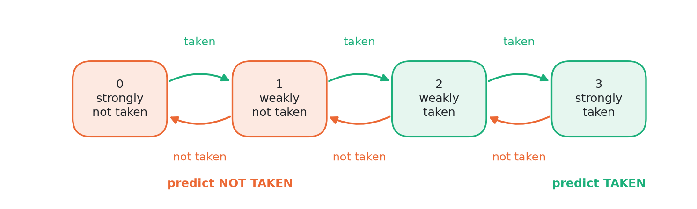

Why 2 bits and not 1? Think of a loop that runs 10 times, then exits, then runs again. With 1 bit the predictor would get the exit wrong *and* the first iteration of the next run wrong (2 mistakes per loop). With 2 bits the single "not taken" at the exit only moves the counter from 3 to 2, so it still predicts taken next time (1 mistake per loop). The extra bit gives the counter some **hysteresis**: one unusual outcome does not flip it.

ChampSim's bimodal has 16,384 counters × 2 bits = 4 KB.

**What bimodal cannot do:** it only knows each branch's own average behaviour. A branch that goes "taken, not taken, taken, not taken, ..." is 50/50 to bimodal, and it gets about half of them wrong, even though the pattern is perfectly regular.

### 4.2 Global history: branches are correlated

Branches in a program are often related to each other. For example:

```
if (x > 0)  { ... }     // branch A
if (x > 10) { ... }     // branch B
```

If A was not taken (x is not positive), then B is certainly not taken either. Knowing what happened at A tells you about B. This is called **correlation**.

To use correlation, the predictor keeps the **global history**: a list of the outcomes (taken or not taken) of the last N branches the program executed, as a string of bits.

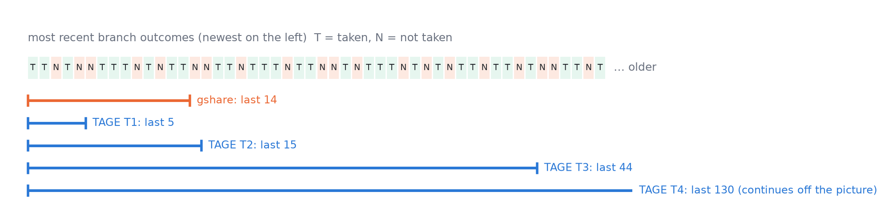

### 4.3 gshare: combine the address with the history

gshare picks a counter using the **branch address XORed with the global history** (XOR is a bit-mixing operation). The same branch now uses a *different* counter depending on what happened just before it, so it can learn "after this pattern of outcomes, this branch is taken".

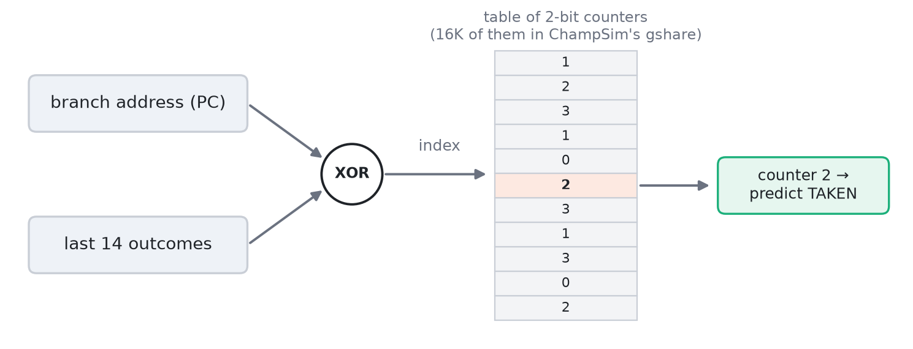

ChampSim's gshare has 16,384 counters (4 KB) and uses the last 14 outcomes.

### 4.4 The two problems with gshare

1. **Aliasing.** Many different (branch, history) combinations land on the same counter, because the table is much smaller than the number of combinations. They then fight over that counter: one wants it to say taken, the other not taken. The counter has no way to know who is asking.
2. **One history length.** gshare has to choose one history length for every branch.
   - A **short** history (say 5) cannot see correlations with branches far in the past.
   - A **long** history (say 100) splits every branch into thousands of different history patterns. Each needs its own counter and its own time to learn, and aliasing gets much worse.

   Different branches need different lengths, and gshare cannot give them that.

TAGE is designed to fix exactly these two problems.

## 5. TAGE, step by step

**TAGE** stands for **TA**gged **GE**ometric history length predictor. It was published by André Seznec and Pierre Michaud in 2006. Predictors built on TAGE by Seznec won several of the international Championship Branch Prediction competitions, and modern high-performance CPUs are widely reported to use TAGE-like designs.

### 5.1 The big idea

> Use **several tables, each looking at a different amount of history**, and for every branch **trust the one with the longest history that actually recognises this situation**.

Short-history tables learn quickly and handle easy branches. Long-history tables catch the rare branches that depend on something far back. **Tags** make sure a table only answers when it really has seen this situation before.

### 5.2 The tables

Our TAGE has 5 tables:

- **T0, the base table**: a plain bimodal predictor, 8,192 two-bit counters indexed by the branch address only. It always has an answer, so it is the fallback.
- **T1–T4, the tagged tables**: 1,024 entries each. Table *Ti* is indexed by mixing the branch address with the last *L(i)* outcomes of the global history.

The history lengths form a **geometric series**: each one is about three times the previous one.

  L(i) = Lmin × (Lmax / Lmin)^((i − 1) / (N − 1))

With the shortest length Lmin = 5, the longest Lmax = 130 and N = 4 tables, this gives **5, 15, 44, 130**.

Why geometric rather than evenly spaced (5, 47, 88, 130)? Most branches need short or medium histories, and only a few need very long ones. A geometric series puts most tables where they are most useful while still reaching far back. The experiments confirm it: geometric spacing gives 7% fewer mispredictions than even spacing.

### 5.3 Tags

Each entry in T1–T4 has three fields (14 bits in total):

- a **3-bit prediction counter** (−4 to +3, where 0 and above means taken), which works like the bimodal counter but with a little more range;
- a **9-bit tag**, computed from the branch address and history in a different way from the index;
- a **2-bit useful counter** (0–3), explained in 5.7.

When TAGE looks up a table, it compares the stored tag with the tag computed for the current branch. **If the tags match, the table "hits"**: this entry was created for this branch in this history situation, so its counter is trustworthy. **If they differ, the table "misses"** and is ignored.

This is how TAGE beats aliasing. In gshare, an entry used by another branch still gives an answer, and usually a wrong one. In TAGE that entry's tag will not match, so it is ignored.

The tags are **partial**: 9 bits, not the full address. A full tag would be wasteful. With 9 bits, a random unrelated entry matches by accident only 1 time in 512, which is rare enough. The tag-width experiment shows this: 4-bit tags (1-in-16 accidental matches) are clearly worse, while beyond 8–9 bits there is no further gain.

### 5.4 Making a prediction

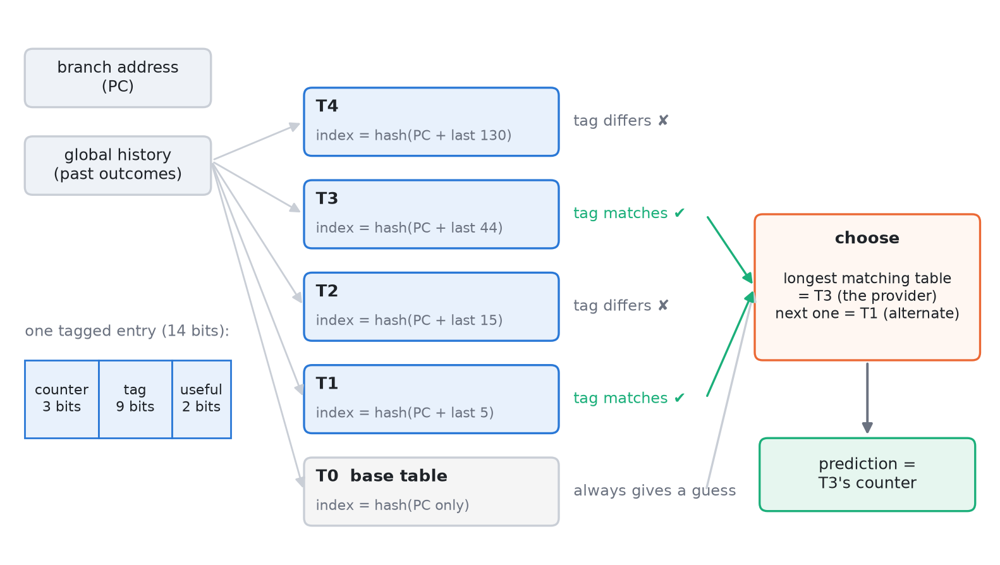

For each conditional branch:

1. Compute an index and a tag for each of T1–T4, from the branch address and that table's amount of history.
2. Look up all tables at once. Check which tagged tables hit.
3. The hitting table with the **longest history** is the **provider**. Its counter gives the prediction.
4. The next-longest hitting table, or T0 if there is none, gives the **alternate prediction** (altpred). It is kept as a backup (see 5.8).
5. If no tagged table hits, T0's bimodal counter gives the prediction.

**Worked example.** Suppose T1 and T3 hit while T2 and T4 miss. T3 is the provider, because it has seen this exact branch with this 44-outcome history before, and its counter says +2, so predict taken. T1 is the alternate.

### 5.5 Learning from the outcome

After the branch executes, TAGE knows the real outcome and updates itself:

- The provider's counter moves toward the outcome (+1 if taken, −1 if not taken), just like a bimodal counter.
- If there was no provider, the base table's counter is updated instead.

### 5.6 Allocation: learning new situations after a mistake

If TAGE **mispredicted**, the provider's history was not long enough to tell this situation apart from others. So TAGE **allocates** (creates) a new entry in a table with a **longer** history than the provider:

- It looks at the entries this branch maps to in the longer tables and picks one whose useful counter is 0 (nobody is relying on it).
- If several are free, it usually picks the shortest one (2 times out of 3), so the predictor tries the cheapest extra history first.
- The new entry gets this branch's tag and a weak counter pointing in the direction that actually happened.
- If none are free, it lowers the useful counters of those entries instead, so one of them can be replaced next time.

This is how TAGE gives each branch "as much history as it needs": a branch that keeps being mispredicted gets entries in longer and longer tables until one of them can tell its situations apart.

### 5.7 Useful counters: protecting good entries

Entries in the tagged tables are precious, because a table has only 1,024 of them. The 2-bit **useful counter** (u) records whether an entry is actually helping:

- If the provider was right **and** the alternate would have been wrong, the entry clearly adds something: u goes up.
- If the provider was wrong and the alternate would have been right, u goes down.

Entries with u > 0 are not replaced during allocation. So that old entries cannot hold on forever, every 256K conditional branches all useful counters are partly cleared (first the high bit, next time the low bit). This **graceful reset** lets entries that have stopped being useful be recycled.

### 5.8 Fresh entries: "use alternate on newly allocated"

A brand-new entry has seen only one outcome, so its counter is weak and unreliable. When the provider is such a weak, fresh entry, sometimes the alternate prediction is the better bet. TAGE keeps a small global 4-bit counter called **USE_ALT_ON_NA** that learns, over time, whether trusting the alternate in this situation pays off, and follows it.

### 5.9 Folded history (a hardware trick)

The longest table uses 130 history bits, but its index is only 10 bits (1,024 entries). Squeezing 130 bits into 10 by XORing them all on every branch would be slow. Instead, TAGE keeps a **folded history**: a 10-bit register that is updated a little on each branch. The newest outcome is shifted in, the outcome that just fell out of the 130-bit window is cancelled out, and the overflow bit is wrapped around. This gives the same result as folding all 130 bits from scratch, at a tiny cost per branch. You do not need the details; just know that it is how long histories are made cheap.

### 5.10 Storage: where "9 KB" comes from

- Base table: 8,192 counters × 2 bits = 16,384 bits = 2 KB.
- Tagged tables: 4 tables × 1,024 entries × 14 bits = 57,344 bits = 7 KB.
- Plus the 4-bit USE_ALT_ON_NA counter.
- **Total: about 9 KB.** (1 KB = 1,024 bytes = 8,192 bits.)

## 6. The tools

### 6.1 Traces and the 8 programs

You cannot easily run a real program on a CPU design that only exists in software. Instead, researchers record a **trace**: a file listing every instruction a real program executed (its address, what kind it is, which registers and memory addresses it used, and for branches whether it was taken). A simulator then replays the trace.

We used traces from **DPC-3** (the 3rd Data Prefetching Championship), which are recordings of the **SPEC CPU2017** benchmark programs. SPEC CPU2017 is the standard set of test programs the industry uses to compare processors. We picked 8 programs with very different branch behaviour:

| trace | what the program does | branch behaviour |
|---|---|---|
| 600.perlbench | the Perl language interpreter | many branches, fairly predictable |
| 602.gcc | the GCC C compiler | many branches, very predictable |
| 605.mcf | vehicle scheduling for public transport (network optimisation) | hard, data-dependent; also very memory-bound |
| 623.xalancbmk | converting XML documents to HTML | most branches of all, predictable with history |
| 625.x264 | video encoding | few branches, predictable with history |
| 631.deepsjeng | a chess engine | hard (game-tree search) |
| 641.leela | a Go-playing engine | the hardest (game-tree search) |
| 657.xz | data compression | hard, data-dependent |

The `_s` in the names means the "speed" version of each benchmark. The number at the end (such as `210B`) indicates where in the program's run the recording was taken, in billions of instructions. Each experiment uses the first 120 million instructions of each trace, so only the first 80 MB of each (much larger) trace file was downloaded.

### 6.2 ChampSim

**ChampSim** is a free, open-source CPU simulator used widely in research and in academic competitions (including DPC-3). It models a modern out-of-order CPU in detail: the pipeline, the caches, main memory, the BTB, and a pluggable branch predictor. You give it a trace and it reports how many cycles the CPU would take, and therefore the IPC, along with branch statistics.

A branch predictor in ChampSim is a small C++ module with two main functions:

- `predict_branch(...)`: called when a branch is fetched; returns the guess (taken or not).
- `last_branch_result(...)`: called with the real outcome so the predictor can learn.

Our TAGE, and the resizable bimodal and gshare, are such modules. `setup.sh` downloads ChampSim at the exact version we used and links our modules into it, and `configs/all.json` tells ChampSim to build one simulator program per predictor.

ChampSim is accurate but slow: one run of 20 million instructions takes a few minutes.

### 6.3 Our fast replay tool (bp_driver)

To measure only **prediction accuracy (MPKI)**, we do not need to simulate caches, memory or the pipeline. We only need to feed each branch to the predictor in order and count the mistakes. `tools/bp_driver.cc` does exactly that:

- it compiles **the very same predictor source files** that ChampSim uses (not copies), so it tests the same code;
- it reads the same traces and classifies branches exactly the way ChampSim does;
- a 120-million-instruction run takes about **one second** instead of tens of minutes.

That speed allowed every MPKI number to use a much longer measurement window: **20M instructions of warm-up plus 100M measured**, instead of the 10M + 10M used for the slow full simulations.

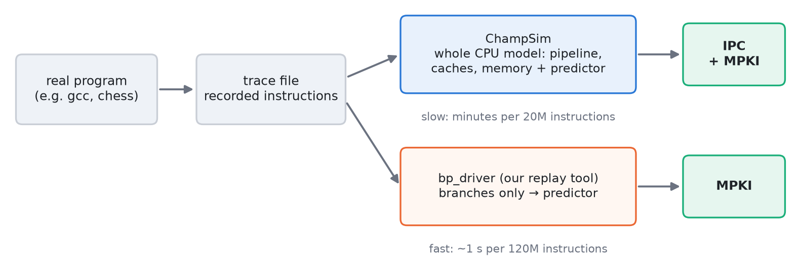

**Is it trustworthy?** We ran both on the same instructions and compared. For each program, the difference between the two is the same for all three predictors, and it comes from the BTB: ChampSim also counts a branch as mispredicted when the direction was right but the BTB did not know the target. That has nothing to do with the direction predictor. Both tools rank the three predictors in exactly the same order on all 8 programs (report Section 5.7). As a further check, the whole sweep was run on both a Mac and the Ada cluster, and all 360 results matched exactly.

### 6.4 Ada and SLURM

**Ada** is IIIT's high-performance computing cluster: many powerful computers shared by students and researchers. You do not run programs on it directly. You submit a **job** to a queue system called **SLURM**, which runs it when computers are free.

- A job is described in a script (`ada/*.sbatch`) that says how many CPU cores, how much memory and how much time it needs, and what commands to run.
- `sbatch ada/ipc.sbatch` submits the job; `squeue` shows the queue.
- Our three jobs: `build.sbatch` compiles ChampSim and the replay tool, `mpki.sbatch` runs the 360 accuracy runs (about 2 minutes), and `ipc.sbatch` runs the 360 full ChampSim simulations (about 3 hours, 10 at a time).
- Their logs are in `logs/`. The first two build attempts failed (one download problem and one leftover file from the Mac). That is why there are three build logs, and only the last one succeeded.

## 7. The experiments

Each experiment changes one thing and keeps everything else at the default (4 tagged tables, lengths 5–130, 1K entries per table, 9-bit tags). That is 45 configurations in total, each run on all 8 programs.

| experiment | question | what was varied |
|---|---|---|
| **Baseline** | Is TAGE better than bimodal and gshare? | the three predictors at their default sizes |
| **Storage budget** | Is TAGE better only because it is bigger? | all three predictors from about 2 KB to about 64 KB |
| **Number of tables (fixed size)** | Do more tables help? | 1, 2, 3, 4, 6, 8 tables of 1K entries (memory grows) |
| **Number of tables (fixed budget)** | Is it better to have a few big tables or many small ones? | 1, 2, 4, 8, 16 tables sharing 16 KB |
| **Longest history (Lmax)** | How far back should TAGE look? | 16, 32, 64, 130, 256, 512, 1024 |
| **Shortest history (Lmin)** | How short should the shortest table be? | 2, 5, 10, 20 |
| **Spacing** | Is geometric spacing really better? | geometric 5, 15, 44, 130 vs even 5, 47, 88, 130 |
| **Tag width** | How many tag bits are needed? | 4, 6, 8, 9, 11, 13 bits |

Because our TAGE reads its settings from **environment variables** (`TAGE_NUM_TABLES`, `TAGE_MAX_HIST` and so on), one compiled program covers every configuration. `scripts/experiments.py` lists all 45 configurations and their settings.

## 8. The results, explained

All figures below are from `results/figures/`, and the full tables are in `results/summary.md` and the report.

### 8.1 TAGE vs bimodal vs gshare

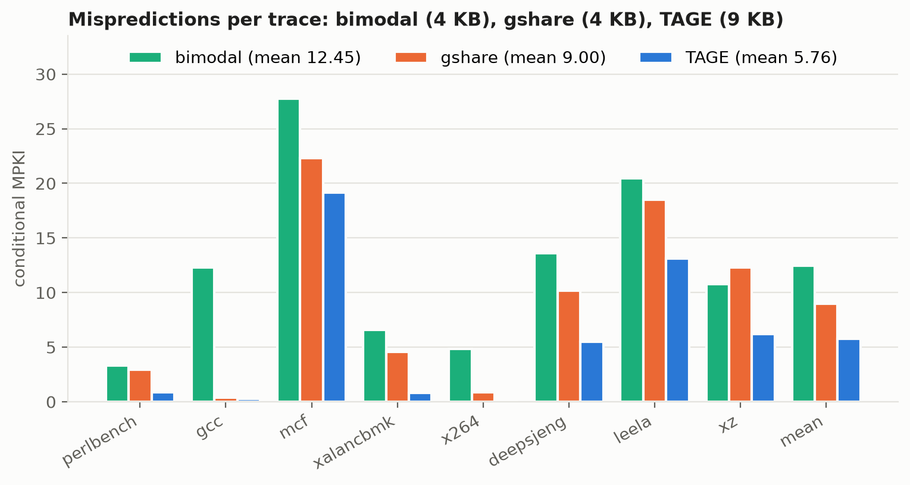

- **TAGE (blue) is the shortest bar on every program.** Averaged over the 8 programs it makes 5.76 mistakes per 1000 instructions, against 9.00 for gshare and 12.45 for bimodal.
- **The biggest wins (about 70–83% fewer mistakes) are on perlbench, xalancbmk and x264.** Their branches depend on history further back than gshare's 14 outcomes, and TAGE's 44- and 130-outcome tables can see it.
- **On xz, gshare is even worse than bimodal.** Its 14-bit history spreads each branch over many counters that then interfere with each other. TAGE avoids this because it falls back to the base table (or a short table) whenever the longer tables have nothing useful.
- **mcf and leela stay hard for everyone.** Their branches depend on the data being processed (pointer-chasing comparisons in mcf, game-tree search in leela), not on earlier branches, so no history-based predictor can learn them well.

### 8.2 Is it just more memory?

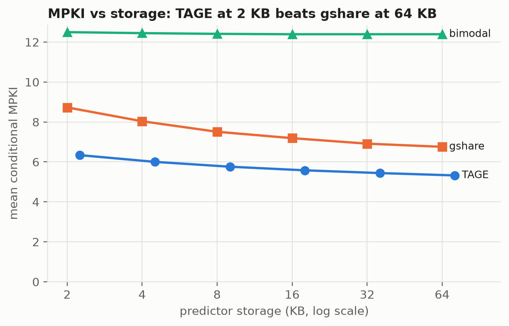

- **The smallest TAGE (2.25 KB) beats the largest gshare (64 KB):** 6.34 against 6.76. TAGE's advantage comes from its design, not its size.
- **Bimodal stops improving at about 4 KB.** It has no history, so once every branch has its own counter, more counters do nothing.
- **Both history-based predictors improve less and less as memory doubles.** The mistakes that remain are dominated by mcf and leela, which more memory does not fix.

### 8.3 How many tables?

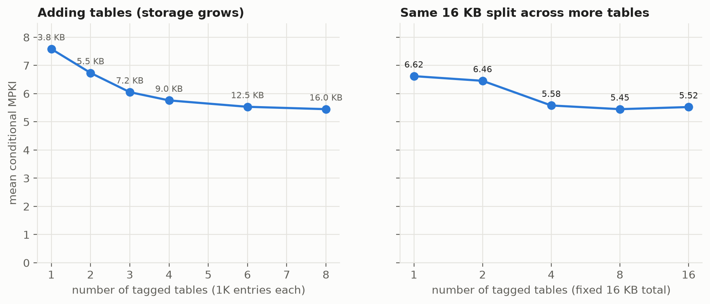

- **More tables help, with diminishing returns.** Going from 1 to 4 tables cuts mistakes by 24% (7.59 to 5.76); going from 4 to 8 cuts only another 5%.
- **With a fixed 16 KB budget, one big table (6.62) is clearly worse than four tables sharing the same 16 KB (5.58)**, and even worse than the default four-table TAGE that uses only 9 KB (5.76). The number of different history lengths matters more than raw capacity. This is the central claim of the TAGE paper, and our results confirm it.
- **About 8 tables is the sweet spot** at 16 KB. At 16 tables each table has only 512 entries, which is too small, and the history lengths become so close together that tables duplicate each other.

### 8.4 History lengths

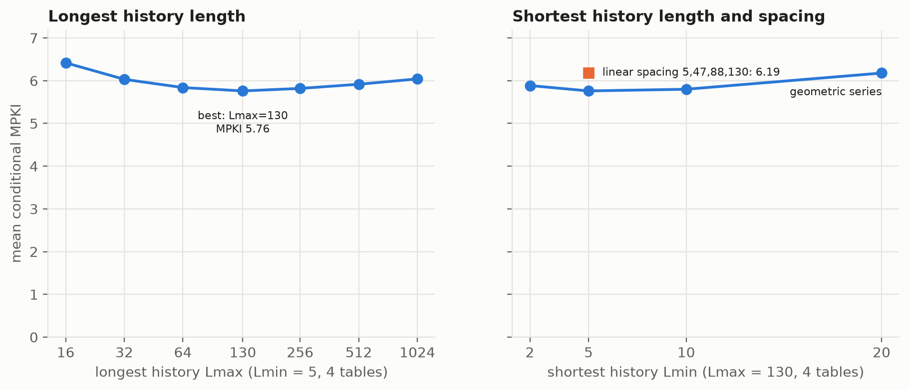

- **The longest history has a clear best value around 130.** Too short (16) and the long correlations are lost. Too long (1024) and, with only 4 tables, the series has to jump from 5 to 29 to 174 to 1024. That skips the middle lengths most branches need, and the 1024-outcome table takes very long to learn.
- **The shortest history is best around 5.** Raising it to 20 removes the short-history table that many simple branches rely on.
- **Geometric beats even spacing by 7%** (5.76 vs 6.19). Even spacing wastes tables on similar long histories and leaves too few short ones.

### 8.5 Tag width

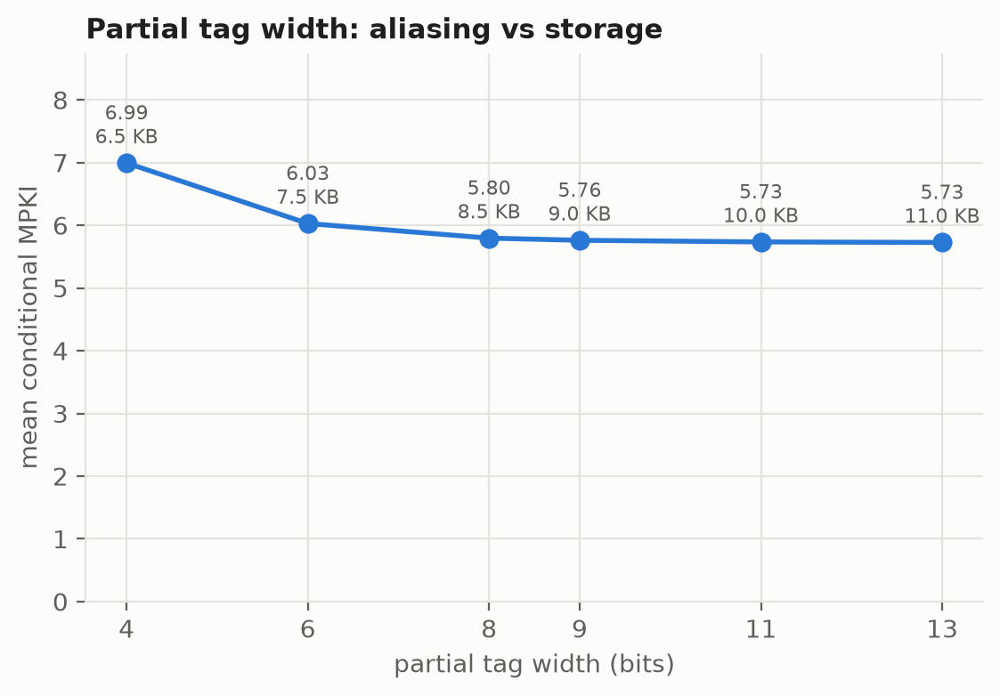

- With 4-bit tags, about 1 lookup in 16 of an unrelated branch matches by accident, and TAGE trusts the wrong entry: 21% more mistakes.
- From about 8–9 bits on there is no further improvement (5.73 at 11 and 13 bits), because accidental matches are already rare. Wider tags only cost memory.

### 8.6 Does it make the CPU faster?

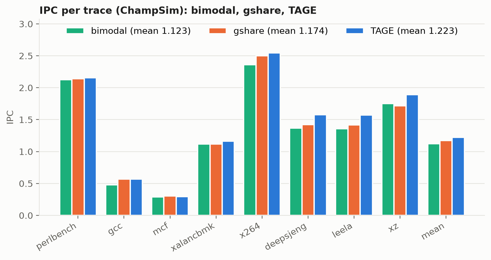

- **TAGE gives the highest average speed: 4.2% faster than gshare and 8.9% faster than bimodal.**
- **The gains are biggest (10–11%) on deepsjeng, leela and xz.** These have many hard branches, and their speed is limited mainly by branches, not memory.
- **On perlbench, gcc and x264 the gain is small (0–2%)**, because gshare already gets almost every branch right there, so there is little left to win.
- **mcf barely changes**: it spends most of its time waiting for memory, so branch prediction hardly matters. The one odd point, ChampSim's built-in gshare showing slightly higher speed on mcf, is not explained by prediction accuracy (that gshare actually mispredicts more), and the report treats it as an outlier.

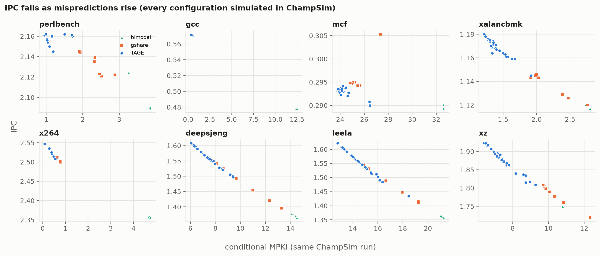

This figure ties the two measurements together. Within each program, all the points (every predictor and every configuration) fall on almost a straight line: **each extra misprediction per 1000 instructions costs about 2% of speed** (from 1% on perlbench to 3.3% on xalancbmk). So the many fast MPKI experiments really do tell us about performance. The exception is mcf, whose speed is set by memory: there the line is almost flat.

## 9. The repository, file by file

| path | what it is |
|---|---|
| `README.md` | the front page: summary, headline numbers, layout |
| `REPORT.md`, `REPORT.pdf` | the formal project report |
| `docs/GUIDE.md`, `docs/GUIDE.pdf` | this guide |
| `docs/make_guide_figures.py` | draws the diagrams in this guide |
| `predictors/tage/tage.h`, `tage.cc` | **the TAGE implementation** (about 300 lines of C++) |
| `predictors/gshare_param/` | gshare whose size is set at run time (`GSHARE_LOG_SIZE`) |
| `predictors/bimodal_param/` | bimodal whose size is set at run time (`BIMODAL_LOG_SIZE`) |
| `configs/*.json` | ChampSim build settings; `all.json` builds all five simulator programs at once |
| `setup.sh` | downloads ChampSim at the exact version used and plugs our predictors into it |
| `tools/bp_driver.cc` | the fast replay tool (Section 6.3) |
| `tools/build_driver.sh` | compiles the replay tool |
| `scripts/get_traces.sh` | downloads the 8 traces (first 80 MB of each) |
| `scripts/experiments.py` | the list of all 45 configurations and the 8 traces |
| `scripts/run_mpki.py` | runs the accuracy sweep with the replay tool and writes `results/mpki.csv` |
| `scripts/run_sweeps.py` | runs the full ChampSim simulations and writes `results/raw/` (it skips runs that already finished) |
| `scripts/parse_results.py` | reads `results/raw/` and writes `results/results.csv` |
| `scripts/plot_results.py` | draws all result figures and writes `results/summary.md` |
| `scripts/make_pdf.py` | turns `REPORT.md` and this guide into PDFs |
| `ada/*.sbatch` | the jobs submitted to the Ada cluster |
| `logs/` | the output of those jobs |
| `results/mpki.csv` | 360 rows: accuracy results (config, program, MPKI, accuracy, ...) |
| `results/results.csv` | 360 rows: full-simulation results (IPC, MPKI, ...) |
| `results/raw/` | the raw ChampSim output of each of the 360 simulations |
| `results/figures/` | the 9 result figures |
| `results/summary.md` | all result tables in one place |

## 10. Running it yourself

You do not need to rerun anything: all results are already in `results/`. If you want to see it work, on a Mac or Linux machine with a C++ compiler, Python 3 and `git`:

```
./setup.sh                    # get ChampSim and plug our predictors in
scripts/get_traces.sh         # download the 8 traces (~640 MB)
cd ChampSim && vcpkg/bootstrap-vcpkg.sh && vcpkg/vcpkg install
./config.sh ../configs/all.json && make -j && cd ..
tools/build_driver.sh
```

Then, for example, a quick full simulation of TAGE on x264:

```
ChampSim/bin/champsim_tage --warmup-instructions 1000000 \
  --simulation-instructions 5000000 traces/625.x264_s-18B.champsimtrace.xz
```

It prints the TAGE settings (`TAGE config: tables=4 hist=[5,15,44,130] ... storage_kb=9.00`), then the IPC and the branch statistics. To try a different design, set an environment variable first, for example `TAGE_NUM_TABLES=8`. The complete pipeline is in Section 7 of the report.

## 11. Viva preparation

### 11.1 The one-minute explanation

> "CPUs have to guess the direction of every branch before they know it, and each wrong guess wastes 15–20 cycles. Simple predictors like bimodal remember each branch's usual direction; gshare also uses the recent history of branch outcomes, but only one fixed length of it. TAGE uses several tables with geometrically increasing history lengths, 5, 15, 44 and 130, and tags so that a table only answers when it has really seen this situation. The longest matching table makes the prediction. I implemented a simplified TAGE in ChampSim, compared it with bimodal and gshare on 8 SPEC2017 programs, and swept its design parameters. TAGE cut mispredictions by 36% compared with gshare, which made the CPU 4.2% faster, and even a 2 KB TAGE beat a 64 KB gshare. The experiments confirm the paper's main claim: having several geometrically spaced history lengths matters more than total storage."

### 11.2 Likely questions and good answers

**Why is branch prediction needed at all?**
The pipeline fetches instructions long before a branch is resolved. Waiting at every branch (about 1 in 8 instructions) would waste most of the CPU's time, so it predicts and fetches speculatively. Wrong predictions flush the pipeline.

**What is the difference between MPKI and accuracy, and why use MPKI?**
Accuracy is the percentage of branches predicted correctly. MPKI is mistakes per 1000 instructions. MPKI is proportional to the time wasted, it accounts for how often branches occur, and small accuracy differences (97% vs 99%) become clear (3× fewer mistakes).

**Why does gshare struggle?**
It uses one history length for every branch. Short histories miss long-range correlations, and long ones dilute every branch over many counters and increase aliasing. Untagged entries also give answers for branches they were never trained on.

**What do the tags do? Why only 9 bits?**
They let a table answer only when the entry belongs to this branch and history. Otherwise TAGE falls back to shorter tables. 9 bits make accidental matches rare (1 in 512); our sweep shows 4 bits hurt by 21% and more than 9 bits gives nothing.

**What are the provider and the alternate prediction?**
The provider is the matching table with the longest history; it makes the prediction. The alternate is the next-longest match (or the base table), used when the provider is a fresh, untrusted entry.

**When are new entries created?**
Only after a misprediction, in a table with a longer history than the provider, in a slot whose useful counter is 0. Preferring the shortest such table (2/3 of the time) gives each branch only as much history as it needs.

**What is the useful counter for?**
It marks entries that do better than the alternate, so they are not overwritten. It is periodically half-cleared so that stale entries can be recycled.

**Why geometric history lengths?**
They cover a huge range (5 to 130) with few tables, putting more tables at the short and medium lengths most branches need. Our test: geometric 5.76 MPKI vs evenly spaced 6.19.

**Why did you write a separate replay tool? Isn't that cheating?**
ChampSim takes minutes per run and we needed 360 runs plus longer windows. The tool compiles the same predictor source files and calls them in the same order as ChampSim. We validated it: the per-program difference is the same for all predictors (it comes from BTB target misses, not direction), the predictor ranking is identical on all 8 programs, and all IPC numbers do come from full ChampSim runs.

**Why does mcf barely speed up?**
It is memory-bound: it waits on cache misses most of the time, so branch mispredictions are a small part of its run time. Its IPC stays between 0.289 and 0.295 over all configurations.

**Why is the IPC gain (4%) so much smaller than the MPKI gain (36%)?**
Mispredictions are only one source of lost time; caches and memory are another. On programs where gshare is already nearly perfect (gcc, x264) there is little left to gain, and on memory-bound ones (mcf) branches barely matter. On branch-limited programs the gain is 10–11%.

**What would you do next?**
Add the parts of the full TAGE-SC-L design that we left out: a loop predictor for loops with a fixed trip count, and a statistical corrector for branches that are only biased rather than correlated. We could also try more tables with longer histories, and run longer simulations on more programs.

**How is your TAGE "simplified" compared with the paper's?**
It has 4 tagged tables plus a base table and no loop predictor or statistical corrector. It updates history immediately rather than modelling speculative history repair, which is valid because ChampSim calls predict and update back to back for each branch in program order.

## 12. Glossary

- **Address / PC (program counter):** the memory location of an instruction; the PC holds the one being worked on.
- **Aliasing:** two different branches (or situations) sharing one predictor entry and interfering with each other.
- **Allocation:** creating a new entry in a TAGE table after a misprediction.
- **Alternate prediction (altpred):** TAGE's second-best prediction, from the next-longest matching table or the base table.
- **Base table / T0:** TAGE's plain bimodal table, which always has an answer.
- **Benchmark:** a standard program used to compare computers.
- **Bimodal:** a predictor with one 2-bit counter per branch address.
- **Bit, byte, KB:** a bit is a 0 or 1; a byte is 8 bits; a KB is 1,024 bytes.
- **Branch:** an instruction that can change which instruction runs next.
- **BTB (branch target buffer):** remembers where branches jump to.
- **ChampSim:** the open-source CPU simulator used in this project.
- **Conditional branch:** a branch that is taken only if a condition holds.
- **Correlation:** when one branch's outcome tells you something about another's.
- **Counter (saturating):** a small number that counts up on taken and down on not taken and stops at its limits.
- **Cycle:** one tick of the CPU clock.
- **Flush:** throwing away wrongly fetched instructions after a misprediction.
- **Folded history:** a cheap way to compress a long history into a short index.
- **Geometric mean:** the average used for speeds (the n-th root of the product).
- **Geometric series:** numbers that each grow by the same factor (5, 15, 44, 130 grow about 3× each step).
- **Global history:** the recent outcomes of all branches, as a string of bits.
- **gshare:** a predictor that indexes counters by the branch address XOR the global history.
- **IPC:** instructions completed per cycle; higher means a faster CPU.
- **Misprediction:** a wrong guess by the branch predictor.
- **MPKI:** mispredictions per 1000 instructions; lower is better.
- **Out-of-order execution:** running instructions when their inputs are ready, not strictly in program order.
- **Pipeline:** the assembly line of steps (fetch, decode, execute, ...) that instructions go through.
- **Provider:** the TAGE table with the longest history whose tag matches; it makes the prediction.
- **RAS (return address stack):** predicts where function returns go.
- **SLURM / sbatch / job:** the queue system on Ada, the command to submit to it, and a unit of work.
- **SPEC CPU2017:** the industry-standard benchmark suite the traces come from.
- **Speculative execution:** working ahead along a predicted path before knowing it is correct.
- **Tag:** a few bits stored in an entry to check that it belongs to the current branch and history.
- **TAGE:** TAgged GEometric history length predictor, the subject of this project.
- **Taken / not taken:** whether a conditional branch jumped or fell through.
- **Trace:** a recorded list of the instructions a real program executed.
- **Useful counter (u):** a 2-bit counter marking TAGE entries that are worth keeping.
- **Warm-up:** instructions run before measuring, so the predictor has learned first.
- **XOR:** a bit operation that mixes two numbers; used to combine addresses and history.
